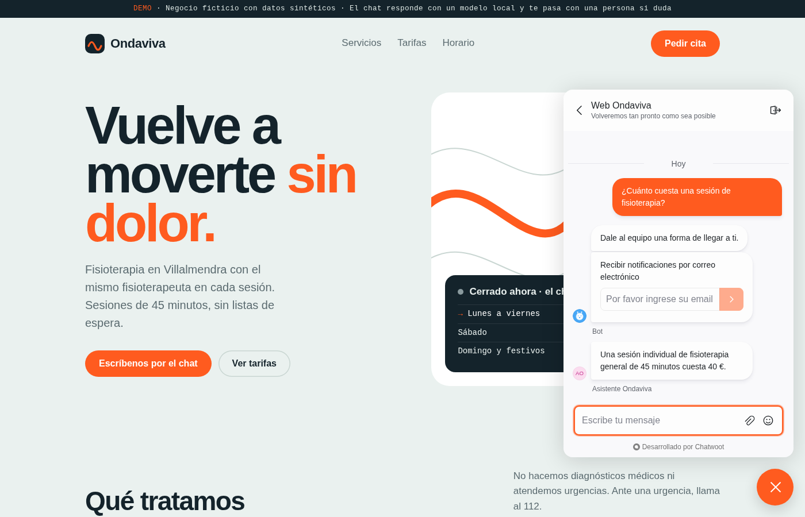
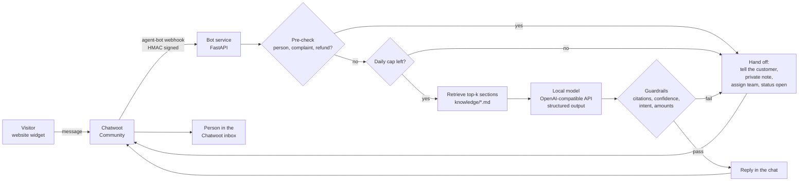
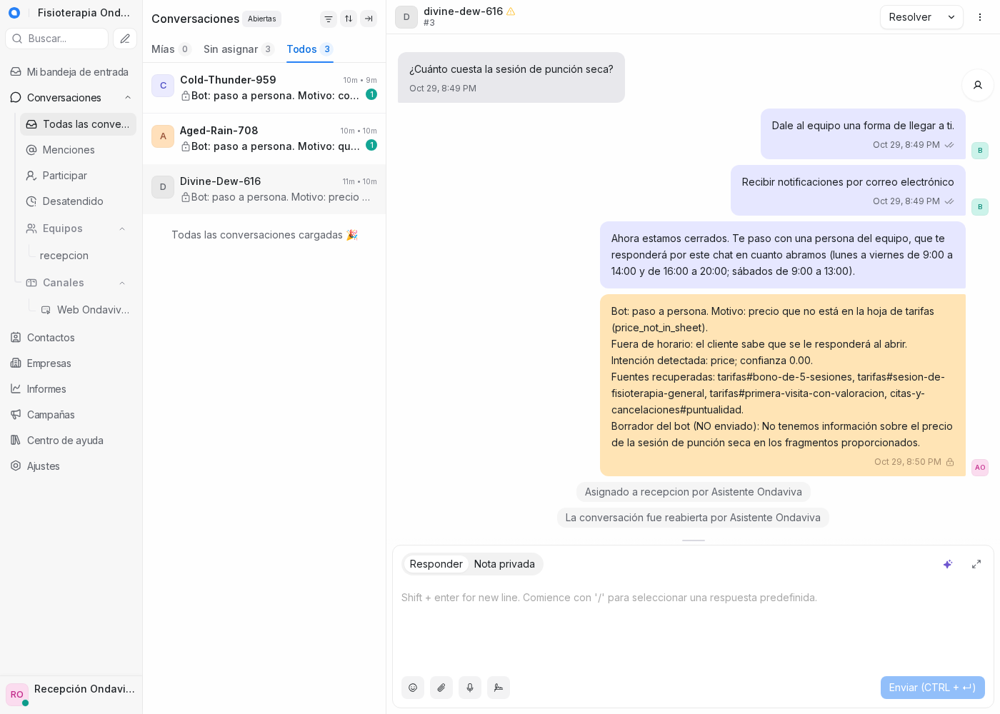

# WhatsApp support demo: a bot that hands off to a person

<p align="center">
  
</p>

<h3 align="center">A Chatwoot bot for a small business that answers from the business's own documents and passes the chat to a person when it is unsure.</h3>

<p align="center">
  
  
  
  
  <a href="https://github.com/SaskullOps/whatsapp-support-demo/actions/workflows/ci.yml"></a>
</p>

<p align="center">
  <a href="#quick-start">Quick start</a> · <a href="#how-it-works">How it works</a> · <a href="#guardrails">Guardrails</a> · <a href="#troubleshooting">Troubleshooting</a> · <a href="#security-notes">Security</a>
</p>

This is a runnable demo of customer support for a small business. A bot answers routine questions from the business's FAQ and price sheet, has to cite the section it used, and passes the conversation to a person whenever it is unsure or the topic is sensitive.

The business is fictitious: Fisioterapia Ondaviva, a physiotherapy clinic in an invented town. All documents are synthetic and in Spanish. The chat runs on Chatwoot's website widget, so you can try the whole flow without a Meta account. The WhatsApp Cloud API path is described [below](#taking-it-to-whatsapp). I wrote up the reasoning behind it in [a blog post](https://alexguardiola.dev/en/blog/whatsapp-support-bot-demo).

## Why

Small businesses get the same ten questions every day (opening hours, prices, how to cancel). A bot can answer those. It goes wrong when it invents a price, gives medical advice or argues with an angry customer. This demo makes the safe behaviour the default:

- The bot only answers from the business's documents, and every answer must cite them.
- Price questions must cite the price sheet. Any euro amount in an answer has to appear in one of the sections the answer cites.
- Complaints, refunds, medical or legal questions, bookings and requests for a person go to a human, with a private note explaining why.
- A daily usage cap stops the bot and leaves the inbox to people.
- Meta has banned general-purpose assistants on WhatsApp since 15 January 2026, so off-topic requests get a fixed refusal.

## Requirements

- Linux with Docker Engine and the Docker Compose plugin (`docker compose`). Tested on x86_64 with Docker Engine 29.9 and Compose 5.6.1. The upstream images also publish arm64 builds, which I have not tested.
- About 4 GB of disk for the images, and 2 GB of free RAM for the stack plus what the model needs.
- `make`, `python3` 3.10 or newer (the scripts use only the standard library) and [uv](https://docs.astral.sh/uv/) for `make test`.
- An OpenAI-compatible model endpoint. The default is a local [Ollama](https://ollama.com) on the host, listening on `127.0.0.1:11434`, with `qwen3:14b` (`ollama pull qwen3:14b`, a 9.3 GB download). A GPU helps a lot. No cloud model is called.
- Free ports 3010 and 8088 on `127.0.0.1`.

## Quick start

```sh
git clone --branch v0.1.0 https://github.com/SaskullOps/whatsapp-support-demo.git
cd whatsapp-support-demo
make up          # writes .env with random local credentials, starts Chatwoot, the bot and the demo page
make bootstrap   # creates the account, admin, team, website inbox and agent bot through Chatwoot's APIs
```

`make up` returns once Chatwoot answers on port 3010. On my machine that took under 30 seconds with the images already pulled. The first run also pulls about 4 GB of images and builds the bot image.

Then open:

- the demo page with the chat widget: <http://localhost:8088>
- the Chatwoot inbox, which is the human side: <http://localhost:3010>. Log in with `ADMIN_EMAIL` and `ADMIN_PASSWORD` from `.env` (`grep '^ADMIN_' .env`).

Run the scripted conversation and the unit tests:

```sh
make e2e         # six visitor messages through the widget API
make test        # 104 unit tests, no Docker or model needed
```

`make e2e` prints one JSON line per case and exits 0 when every case got a reply. `"status": "pending"` means the bot answered; `"status": "open"` means it handed the conversation to a person, and `note` holds the first line of the private note. Expect three answers (opening hours, a price from the sheet, and the fixed refusal for the prompt injection) and three hand-offs (a price that is not in the sheet, a complaint, a medical question). The model's wording varies from run to run. On my machine, with `qwen3:14b`, `make e2e` took 36 seconds once and about 5 minutes another time (see [Measured numbers](#measured-numbers)).

When you are done:

```sh
make clean       # removes the containers, volumes, the bot image, .env and demo/config.js
```

The upstream images stay in Docker's cache. Remove them with `docker image rm` if you want the disk space back.

Other targets:

| Command | What it does |
|---|---|
| `make e2e` | Sends six scripted visitor messages through the widget API and prints the reply, status, hand-off note and latency for each |
| `make fake` | Restarts the bot with `--fake-llm` (recorded model outputs, no model needed). `docker compose up -d --force-recreate bot` switches back to the model |
| `make test` | Runs the bot's unit tests (`uv run pytest`) |
| `make logs` | Follows the bot and Chatwoot Rails logs |
| `make down` | Stops the stack and keeps the data |
| `make clean` | Stops the stack and deletes this demo's volumes, its locally built image, `.env` and `demo/config.js` (the next `make up` starts from scratch) |

## How it works



- Chatwoot Community (`chatwoot/chatwoot:v4.19.1-ce`) runs with PostgreSQL (the pgvector image, as upstream recommends) and Redis. Conversations in an inbox with an agent bot start as `pending`. The bot replies while they are pending, and a hand-off sets them to `open` for people.
- The bot (`bot/`) is Python 3.12 and FastAPI, with dependencies pinned in `uv.lock`. It receives `message_created` events, ignores anything that is not an incoming customer message in a pending conversation, and replies through Chatwoot's API with the agent bot's token.
- Retrieval splits the Markdown files in `knowledge/` at `##` headings. Each section gets a stable id (`tarifas#bono-de-5-sesiones`) and is ranked with a small BM25 (accent-insensitive, Spanish stop words). For a one-business FAQ this is enough. A larger corpus would move to pgvector in the same Postgres.
- The model is any OpenAI-compatible `/chat/completions` endpoint, called with a JSON schema. Pydantic validates the output into `{answer, cited_chunk_ids, confidence, intent}`. The defaults are `qwen3:14b` in Ollama with reasoning off (`reasoning_effort: none`) and temperature 0.
- The cited section ids go to the bot's log. The customer sees only the answer text, and a hand-off note lists the sections the bot retrieved.
- `llm-relay` exists because some hosts' firewalls drop traffic from Docker bridges to the host, so `host.docker.internal:11434` times out. The relay runs with host networking, publishes no port, and forwards a Unix socket in a shared volume to `127.0.0.1:11434`. If your host allows bridge traffic, you can skip it (see [Configuration](#configuration)).
- The demo page (`demo/`) is a static page served by nginx that embeds the Chatwoot widget. `make bootstrap` writes the widget token to `demo/config.js`.

When the bot hands off, the person in the inbox sees why. This is the "price not in the sheet" case from `make e2e`: the customer got a holding message, and the private note gives the reason, the detected intent and confidence, the retrieved sections and the draft the bot did not send, with any link or email address in it replaced by a placeholder.

<p align="center">
  
</p>

## Guardrails

Every turn ends as a reply or as a hand-off with a reason code. The reason appears in the private note and in the bot's log. If Chatwoot says right before posting that the conversation is no longer the bot's (`conversation_not_pending`), or cannot be asked (`status_unknown`), the bot posts nothing and only logs the reason.

| Check | Where | Hand-off reason |
|---|---|---|
| Customer asks for a person, complains, or asks for a refund (keyword pre-check, no model call) | `policy.precheck` | `human_request`, `complaint`, `refund` |
| Daily cap on model calls or tokens reached | `usage.UsageCap` | `daily_cap` |
| Model unreachable, timeout, or output that fails the schema | `llm`, `policy.decide` | `llm_error` |
| Intent is booking, complaint, refund, medical, legal or human request | `policy.decide` | `intent:<name>` |
| Price question without a cited section from the price sheet | `policy.decide` | `price_not_in_sheet` |
| No citations | `policy.decide` | `no_citations` |
| A cited id that was not among the retrieved sections | `policy.decide` | `invalid_citation` |
| Confidence below 0.6 | `policy.decide` | `low_confidence` |
| An amount in the answer (`40 €`, `€40`, `40 euros`, `1.000 €`) that does not appear in a cited section | `policy.decide` | `price_not_in_sheet` |
| A link, domain, email address or phone number in the answer that does not appear in a cited section | `policy.decide` | `contact_not_in_sources` |
| The answer says something is free (`gratis`, `gratuito`, `sin coste`) and no cited section says so | `policy.decide` | `free_claim_not_in_sources` |

Other rules:

- Off-topic requests get a fixed refusal written by the business, never the model's text.
- Customer messages are untrusted data. They are wrapped in `<customer_message>` tags, and any `<customer_message>`, `<chunk>` or `<context>` tag inside them is removed before the prompt is built, so a message cannot close the delimiter or forge a source. The guardrails above run on the model's output whatever the prompt says. An injected answer is blocked when it breaks one of them: a hand-off intent, a missing or invented citation, low confidence, or an amount, link, email, phone number or "free" claim that the cited sections do not contain. The checks do not prove the wording is grounded: an answer that cites a real section and stays inside those rules is sent even if its sentences are not in the documents. Tests cover both layers, and `make e2e` sends a real injection attempt.
- Business hours are Europe/Madrid, weekdays 9:00–14:00 and 16:00–20:00, Saturday 9:00–13:00. Outside those hours a hand-off tells the customer when someone will reply, and the private note says it arrived out of hours.
- The bot only answers a conversation that is `pending` with no person assigned. The webhook snapshot is checked first, and Chatwoot is asked again right before posting, because a model turn can take a minute. Messages in the same conversation are handled one at a time, so a second message waits for the first and then sees the hand-off. A person who takes the conversation in the moment between that last check and the post can still see one bot message.
- The bot URL carries a random path secret, and the bot verifies Chatwoot's `X-Chatwoot-Signature` HMAC (with a 5-minute timestamp window) using the agent bot's secret. A request whose `X-Chatwoot-Delivery` id or signature was already seen in the last 10 minutes is dropped as a replay.
- Logs record ids, intent, confidence, retrieved and cited sections, tokens and latency per turn. They never record the message text.

## Configuration

`make up` writes `.env` once and keeps it on later runs. Add any of these lines to it, then apply them with `docker compose up -d bot llm-relay`:

| Variable | Default | What it does |
|---|---|---|
| `BOT_LLM_MODEL` | `qwen3:14b` | Model name sent to the endpoint |
| `BOT_LLM_UDS` | `/relay/llm.sock` | Unix socket to `llm-relay`. Set it empty (`BOT_LLM_UDS=`) to call `BOT_LLM_BASE_URL` directly over TCP |
| `BOT_LLM_BASE_URL` | `http://ollama.relay/v1` | OpenAI-compatible base URL. Through the relay the host name is a placeholder, because requests go over the socket |
| `BOT_LLM_API_KEY` | empty (the bot sends `ollama`) | Bearer token, for endpoints that check one |
| `LLM_RELAY_TARGET` | `127.0.0.1:11434` | `host:port` on the host that the relay forwards to |
| `BOT_MAX_CALLS_PER_DAY` | `200` | Model calls per day (Europe/Madrid) before every conversation goes to a person |
| `BOT_MAX_TOKENS_PER_DAY` | `400000` | Same ceiling, counted in tokens |
| `BOT_FAKE_LLM` | `false` | Replay recorded outputs instead of calling a model (what `make fake` does) |

If your host lets containers reach it over the Docker bridge, you can drop the relay from the path:

```sh
BOT_LLM_UDS=
BOT_LLM_BASE_URL=http://host.docker.internal:11434/v1
```

This needs Ollama to listen on an address the bridge can reach. Ollama's default is `127.0.0.1` only, and binding it to `0.0.0.0` also exposes it to your network. The relay exists so you do not have to.

For a remote endpoint, set `BOT_LLM_UDS=`, `BOT_LLM_BASE_URL`, `BOT_LLM_MODEL` and `BOT_LLM_API_KEY`. The bot always sends `reasoning_effort: none`, so check that your endpoint accepts it. The other fixed values (the 0.6 confidence floor, top-k 4, the 120-second model timeout, the timezone) are in `bot/src/support_bot/settings.py`. The bot reads each one from a `BOT_<NAME>` variable, such as `BOT_MIN_CONFIDENCE`, once you pass it in `compose.yaml`.

## Tests

```sh
cd bot && uv run pytest -q
```

The 104 tests cover citation validation, every hand-off intent and reason, the amount, contact and "free" checks, the daily cap (including the reset and persistence), business hours, prompt delimiting and the injection cases, webhook parsing (bot-assigned compared with human-assigned conversations), signature verification and replays, the status re-check before posting and per-conversation ordering (against a fake Chatwoot), the Unix-socket relay, and the `--fake-llm` recordings for the demo script. They need no Docker and no model. CI runs them on every push and pull request.

`--fake-llm` (or `BOT_FAKE_LLM=true`) replays `bot/src/support_bot/recordings.json`. Messages without a recording get an empty, low-confidence reply, so they hand off.

## Troubleshooting

| Symptom | Cause | Fix |
|---|---|---|
| `docker compose up` stops with `required variable BOT_WEBHOOK_SECRET is missing a value: run make env` | There is no `.env`, usually because `docker compose` ran before `make up` | Run `make up`, or `make env` and then the compose command |
| `make bootstrap` prints ``Chatwoot did not answer at http://localhost:3010 within 240s (run `make up` first).`` | The stack is not running, or the migration failed | `docker compose ps`, then `docker compose logs chatwoot-migrate chatwoot-rails` |
| `make bootstrap` prints ``Already bootstrapped (CHATWOOT_ACCOUNT_ID is set in .env). Run `make clean` to start over.`` | It already ran against this `.env` | Nothing to do. `make clean` and `make up` start over with new credentials |
| `make bootstrap` stopped halfway (for example `POST /api/v1/accounts/1/teams failed: HTTP 500`) and a second run fails or creates a second account | Bootstrap only records `CHATWOOT_ACCOUNT_ID` at the end, so a partial run leaves objects in Chatwoot that `.env` does not know about | `make clean && make up && make bootstrap` |
| `make e2e` prints ``Run `make bootstrap` first.`` | `.env` has no widget token yet | Run `make bootstrap` |
| Every message gets the hand-off text, the private note says `el modelo no respondió o devolvió un formato no válido (llm_error)`, and `docker compose logs bot` shows a line such as `llm error: RemoteProtocolError` | The bot cannot reach the model, or the model is not pulled | On the host, `curl http://127.0.0.1:11434/api/tags` should list `qwen3:14b`. `docker compose logs llm-relay` should show `relaying /relay/llm.sock -> 127.0.0.1:11434` |
| Answers take over a minute, or end as `llm_error` hand-offs after about 120 seconds | The model runs mostly on the CPU, or it is still loading | Use a GPU or a smaller model (`BOT_LLM_MODEL`), or try the flow with `make fake` |
| `make e2e` prints `"reply": null` and exits 1 | The bot did not answer at all: it is not running, or it still has the settings from before `make bootstrap` | `docker compose logs bot` (look for `failed to handle conversation`), then `docker compose up -d --force-recreate bot` |

## Measured numbers

These come from two runs of `make e2e` on one x86_64 machine with an RTX 4070 Ti (12 GB). In both, about 8 of the 10 GB that `qwen3:14b` takes were on the GPU and the rest in system RAM.

| Measure | Value |
|---|---|
| Tokens per model turn | 500 to 700 |
| Model turn, second run | 1 to 10 s, the whole `make e2e` in 36 s |
| Model turn, first run | 49 to 63 s, the whole `make e2e` in about 5 minutes. I did not pin down why this run was slower |
| Hand-off from the keyword pre-check (no model call) | under 0.2 s |
| RAM after `make e2e`, seven running containers | about 850 MB, 700 MB of it Chatwoot's Rails and Sidekiq |
| `make up` with the images already pulled | under 30 s |

Treat the latencies as a rough range. They depend on your GPU and on what else is using it.

## Costs

For one small clinic with about 1,000 conversations a month (rough figures from October 2026, excluding VAT):

| Item | Monthly |
|---|---|
| Chatwoot Community, self-hosted | €0 |
| A VPS in the EU (4 vCPU, 8 GB) | about €15–25 |
| WhatsApp messages, beyond the 1,000 free service messages | about €20–55 |
| Model: local, as in this demo | €0 beyond the hardware |
| Model: a small EU-hosted cloud model instead | about €5–10 |

The daily cap (`BOT_MAX_CALLS_PER_DAY`, `BOT_MAX_TOKENS_PER_DAY`) puts a ceiling on model spend if you point the bot at a paid endpoint.

## Limits

- This is a demo, not a product. Bookings are handed to a person rather than written to a calendar, and public holidays are not part of the business-hours rule.
- Retrieval is lexical. Paraphrases with no word in common with the FAQ fall through to a hand-off. That is safe, but it means more hand-offs.
- The keyword pre-check is deliberately broad. For example, "reembolso de mi mutua" goes to a person.
- The amount check covers euro amounts written with digits. Prices written out in words are caught only by the price-sheet citation rule.
- The scripts assume ports 3010 and 8088: `scripts/bootstrap.py` registers `http://localhost:8088` as the website, and `CHATWOOT_URL` in `.env` points to port 3010.
- Chatwoot's `SAFE_FETCH_ALLOW_PRIVATE_NETWORK=true` is set so it can call the bot on the Docker network. In production, leave it unset and give the bot an HTTPS URL.
- Budget about 2 GB of RAM for Chatwoot's Rails and Sidekiq once people use it. The demo run used less (see [Measured numbers](#measured-numbers)). The model needs a GPU or a lot of patience.
- Tested on Linux only. Docker Desktop on macOS and Windows handles `network_mode: host` differently, so the relay may not reach a model on the host there. In that case use the `host.docker.internal` settings above.

## Security notes

- Only two ports are published, both on `127.0.0.1`: Chatwoot on 3010 and the demo page on 8088. PostgreSQL, Redis and the bot are reachable only on the Docker network, and `llm-relay` listens only on a Unix socket in a volume.
- Secrets are generated with random values into `.env`, which has mode 600 and is gitignored. The scripts never print them. They are not only in `.env`: Docker passes them to the containers as environment variables (visible to anyone who can run `docker inspect`), and Chatwoot keeps the agent bot's URL, with its path secret, and its HMAC secret in its database. The bot does not write HTTP access logs, so the path secret does not reach `docker compose logs`.
- Images are pinned by tag and `sha256` digest, and Dependabot proposes updates.
- Chatwoot runs over plain HTTP with `FORCE_SSL=false`. Put it behind HTTPS before it faces anyone else.

To report a vulnerability, see [SECURITY.md](SECURITY.md).

## Taking it to WhatsApp

The bot does not change, because it talks to Chatwoot, not to Meta. What changes is the inbox.

1. In Chatwoot, create a WhatsApp inbox with the WhatsApp Cloud provider. Use Embedded Signup or the manual flow (WABA ID, phone number ID and a permanent system-user token). A self-hosted install needs a Meta App ID, Config ID and App Secret for Embedded Signup.
2. Connect the same agent bot to that inbox (`set_agent_bot`). Hand-off works exactly as it does on the website.
3. Chatwoot must be reachable over public HTTPS for Meta's webhooks, for example behind a reverse proxy or a tunnel.

Meta rules that shape the design:

- Meta charges per delivered message by category (marketing, utility, authentication, service). Messages users send to the business are free. Since 1 October 2026 each number gets 1,000 free service messages a month, so every extra bot message has a cost. That is why the bot sends one message per customer turn.
- Free-form replies are only allowed within 24 hours of the customer's last message. Outside that window you can only send approved templates.
- Since 15 January 2026, WhatsApp's terms ban general-purpose AI assistants. Bots that serve the business's own customers are still allowed. The fixed off-topic refusal exists for this reason.
- Automation must offer a prompt, clear path to a human, which the hand-off rules provide. Business-initiated messages need the customer's opt-in.

## License

MIT, see [LICENSE](LICENSE). The business, its documents and its prices are invented for this demo.

The containers run third-party software under its own licenses:

| Component | License |
|---|---|
| Chatwoot Community (`-ce` image) | MIT (Expat) for everything outside `enterprise/`. The `-ce` image does not include that folder. Agent bots (webhook bots) are part of the open-source core |
| PostgreSQL and pgvector | PostgreSQL License |
| Redis 7.4 | RSALv2 or SSPLv1, at your choice. These are source-available licenses, not OSI-approved open source |
| nginx | BSD-2-Clause |
| Python (bot base image) | PSF License |
| uv | MIT or Apache-2.0 |
| FastAPI, Pydantic | MIT |
| httpx, Uvicorn | BSD-3-Clause |

The base images also contain operating-system packages under their own licenses. Chatwoot, WhatsApp, Meta, Redis and Ollama are trademarks of their owners. This project is not affiliated with any of them.
